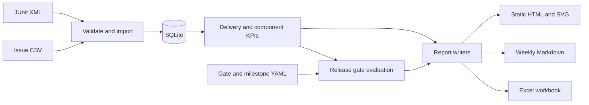

# Software Integration KPI Lab

A Python 3.12 CLI for integration teams that receive test and issue exports from multiple software deliveries. It stores the inputs in one SQLite file, computes delivery and component KPIs, and turns configurable release gates into a GO or NO GO decision with evidence.

## Dashboard

The CI workflow builds a self-contained dashboard from six fictional deliveries. Download the `dashboard` artifact from a workflow run and open `reports/dashboard.html` in a browser. The same artifact contains the weekly status, Excel workbook, raw CLI JSON and coverage evidence.

## Quick start

Run these commands from the repository root with Python 3.12. All commands work in PowerShell or a POSIX shell.

```text
python -m pip install .
integration-kpi import --junit-dir samples/junit --issues samples/issues.csv
integration-kpi kpis --as-of 2025-04-11
integration-kpi readiness --as-of 2025-04-11 --gates config/gates.yml --milestones samples/milestones.yml
integration-kpi report --as-of 2025-04-11 --gates config/gates.yml --milestones samples/milestones.yml --label "Synthetic sample data" --out reports
```

Use `integration-kpi --db path/to/lab.sqlite <command>` to select a different database. The default is `integration.sqlite` in the current directory. `--as-of` defaults to the current UTC day. The sample command fixes the reporting date so the numbers and decisions can be reproduced.

| Output | Contents |
| --- | --- |
| `reports/dashboard.html` | Delivery trends, component detail, issue activity, readiness and risks. Opens offline. |
| `reports/weekly-status.md` | Current reporting week through the snapshot date, with gate failures, milestones and open risks. |
| `reports/integration-kpis.xlsx` | Filterable tables for KPIs, weekly issue activity, gate decisions, milestones and open risks. |

Generate a larger fictional dataset with a deterministic seed. The output directory must be empty.

```text
integration-kpi-sample --output my-sample --seed 42 --deliveries 12
```

## Inputs

**JUnit XML.** Place each suite in `<root>/<delivery>/<level>/<component>/YYYY-MM-DDTHHMMSSZ.xml`. The filename is the UTC run time. Use `unit`, `integration` or `system` for the level. Both `testsuite` and `testsuites` roots are accepted. Each `testcase` needs a unique `classname` and `name` pair within its run. `failure` and `error` count as failed and `skipped` counts as blocked.

**Issues.** Export a UTF-8 CSV with `key,summary,severity,status,created,resolved,component,delivery` headers. Severities are blocker, critical, major, minor and trivial. Use ISO calendar dates. `Closed`, `Done` and `Resolved` require a resolution date. Other statuses require a blank resolution. Severity and status are case insensitive. Match delivery and component names across input types.

**Gates and milestones.** The four keys in [config/gates.yml](config/gates.yml) set the minimum progress and pass rate, maximum blocker count and maximum open critical age. The optional milestone file maps a delivery name to milestone names and ISO dates. A delivery with unavailable test percentages receives a NO GO. The command reports the decision in JSON and uses a nonzero exit code for input or usage errors.

An import can load either input type or both. It validates the full batch before writing it in one transaction. Reimporting a run with the same delivery, level, component and timestamp replaces that run. Issue rows update by key.

## KPI definitions

| KPI | Definition |
| --- | --- |
| Planned | Distinct observed tests through the snapshot date. Identity is component, level, classname and name within a delivery. |
| Executed, passed, failed, blocked | Each test takes its latest observed result. A partial rerun updates only tests it contains. Executed is passed plus failed. |
| Progress and pass rate | Executed divided by planned, and passed divided by executed, respectively. An empty denominator yields N/A. Gates evaluate the full precision. |
| Flaky | Distinct tests with any observed status change between runs of the same delivery, including transitions involving blocked. |
| Open issues and issue age | An issue is open on the snapshot date if it has been created and has no resolution by that day. Age is elapsed calendar days since creation. Counts by severity, average and oldest age, and individual open risks are available. |
| New and closed | Creation and resolution events in Monday-start weeks, counted through the snapshot date. Historical exports omit weeks with no events. |
| Delivery trend | Compare delivery snapshots in order of first observed test run. An issue-only delivery uses its first issue date. Delivery name breaks ties. |

## Architecture



## Verification

GitHub Actions runs Ruff and pytest with coverage on Python 3.12. It also invokes all four CLI commands on the synthetic data and uploads the resulting dashboard and exports.

## Limits

The supplied data is synthetic. The tool reads files from disk and has no live Jira or CI connection. Test planning depends on cases present in exports, so a planned test that never appears in a JUnit run is invisible. Issue exports retain the latest imported metadata and one creation and resolution date per key. Historical issue status transitions and reopen events cannot be reconstructed. Missing issue input can understate the backlog and should be checked before relying on release decisions.
